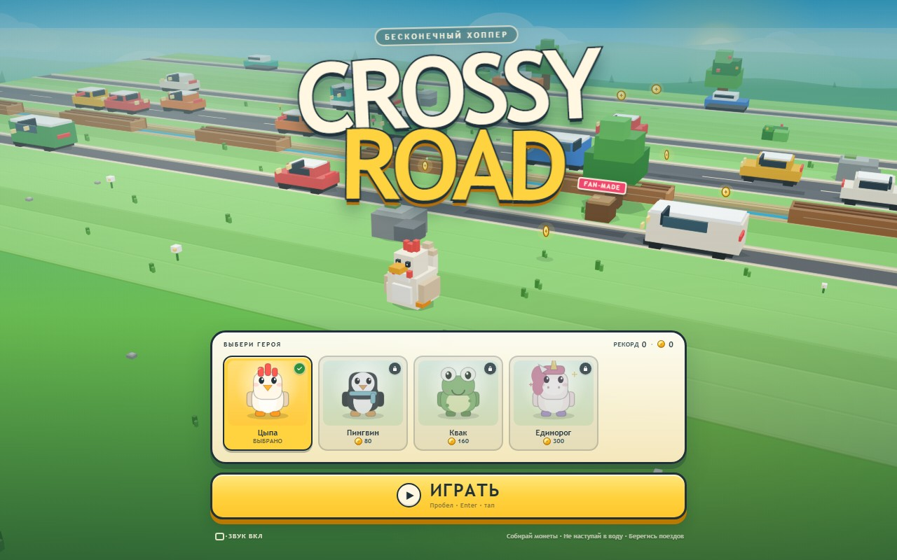
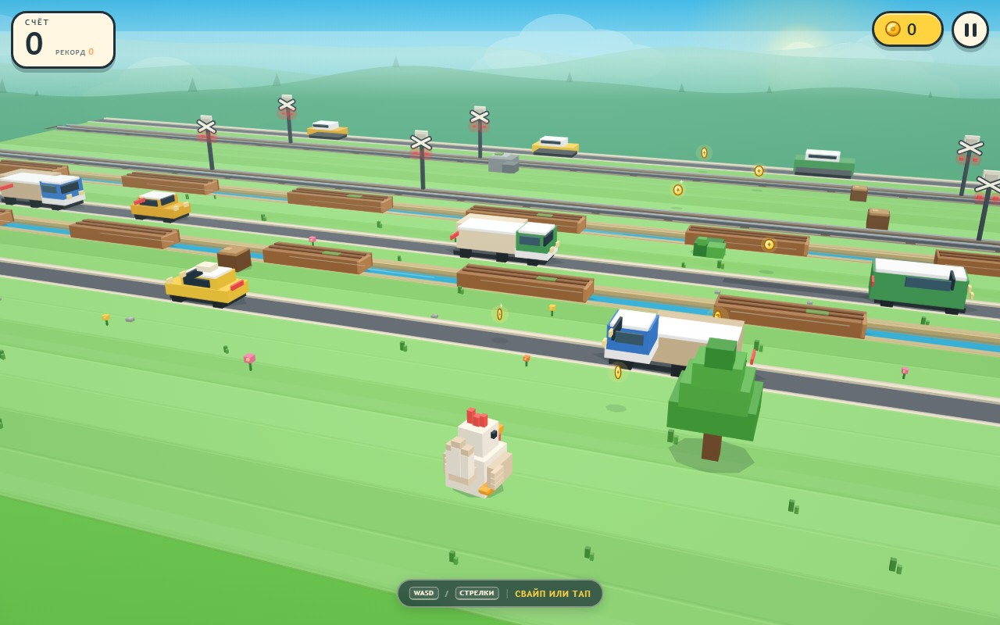

# CROSSY ROAD — бесконечный хоппер

Фанатский клон Crossy Road на чистом Canvas 2D: воксельная 3/4-сцена, процедурный мир, трафик, реки с брёвнами, поезда, монеты, скины и сохранение прогресса. Без фреймворков, сборщиков и внешних ассетов — всё рисуется и звучит кодом.





**Canvas 2D · ванильный JS · без зависимостей · 60 fps**

## Запуск

Самый простой способ:

1. Откройте `index.html` двойным щелчком.
2. Нажмите **ИГРАТЬ**.

Для игры не нужен интернет или установка пакетов.

Если браузер ограничивает `localStorage` на `file://` (прогресс не сохраняется между перезапусками), запустите локальный сервер из папки игры:

```bash
python -m http.server 8000
```

и откройте `http://localhost:8000/`. Подойдёт любой статический сервер (`npx serve`, VS Code Live Server и т. п.).

## Управление

| Действие | Клавиатура | Телефон / мышь |
|---|---|---|
| Вперёд | `W` / `↑` / `Space` | свайп вверх или тап |
| Назад | `S` / `↓` | свайп вниз |
| Влево / вправо | `A` `D` / `←` `→` | свайп влево / вправо |
| Пауза | `Esc` / `P` | кнопка паузы |
| Звук | `M` | кнопка звука в меню и паузе |
| Старт / рестарт | `Enter` / `Space` | кнопки в интерфейсе |

Игра принимает быстрые нажатия: следующий прыжок можно «забуферизовать» во время текущего.

## Что внутри

- **Бесконечная генерация** дорог, рек, железных дорог и безопасных лужаек. После каждой опасной секции гарантирована передышка.
- **Трафик**: легковые, такси, фургоны, автобусы и грузовики, встречные полосы с разной скоростью.
- **Река**: движущиеся брёвна, на которых можно ехать; промах — «Буль!».
- **Поезда**: предупреждающие огни, гудок, длинный состав, который нельзя остановить.
- **Монеты**: обычные и редкие по 3. Тратить их можно на скины.
- **4 героя**: Цыпа, Пингвин, Квак и Единорог. Скины открываются за монеты и сохраняются.
- **Рекорд и монеты** сохраняются в `localStorage`.
- **Процедурный звук** на WebAudio: музыка, прыжки, монеты, всплески, аварии, гудки, фанфары.
- **Адаптивная камера** для десктопа, портрета и короткого ландшафта.
- **Эффекты**: тени, туман, параллакс-холмы, облака, частицы, squash-and-stretch, вспышки и тряска камеры (отключается при `prefers-reduced-motion`).

## Как это устроено

```
index.html          разметка меню, HUD и модальных окон
styles.css          «игрушечный» интерфейс, адаптив, safe-area
js/utils.js         математика, палитра, скины, localStorage
js/audio.js         синтезатор WebAudio и музыкальный секвенсор
js/renderer.js      псевдо-3D рендерер: камера, воксели, небо, частицы
js/world.js         генерация мира, физика игрока, трафик и события
js/world-draw.js    отрисовка земли, машин, брёвен, поездов и героя
js/game.js          игровой цикл, ввод, UI, магазин и сохранения
tools/smoke-test.mjs  автономный smoke-тест на Node без браузера
```

Рендерер — это маленький painter’s-algorithm воксельный движок на Canvas 2D:

- перспективная камера с ручным `project()`;
- кубики собираются из восьми вершин и видимых граней;
- объекты сортируются по глубине **по рядам**, поэтому ближняя трава корректно перекрывает дальние машины;
- шейдинг граней, туман, отрисовка теней и billboard-монет;
- LOD для дальнего трафика и адаптивный pixel ratio, чтобы держать 60 fps.

## Тест

Smoke-тест не требует браузера, Playwright или установки зависимостей:

```bash
node tools/smoke-test.mjs
```

Он поднимает игру в лёгкой заглушке DOM/Canvas, проверяет загрузку, старт, паузу, смерть и рестарт, магазин скинов, генерацию всех типов рядов, физику прыжка, езду на бревне, столкновения с машиной и поездом, а также ресайз под мобильный экран.

## Совместимость

Современные Chrome, Edge, Firefox и Safari. Нужны Canvas 2D, WebAudio (звук опционален) и `localStorage` (иначе прогресс живёт только в памяти вкладки). Игра уважает `prefers-reduced-motion` и safe-area на телефонах.

## Дисклеймер

Это неофициальный фанатский проект, вдохновлённый Crossy Road. Он не связан с Hipster Whale и не использует их ассеты или код. Все графика, звук и логика созданы процедурно в этом проекте.
